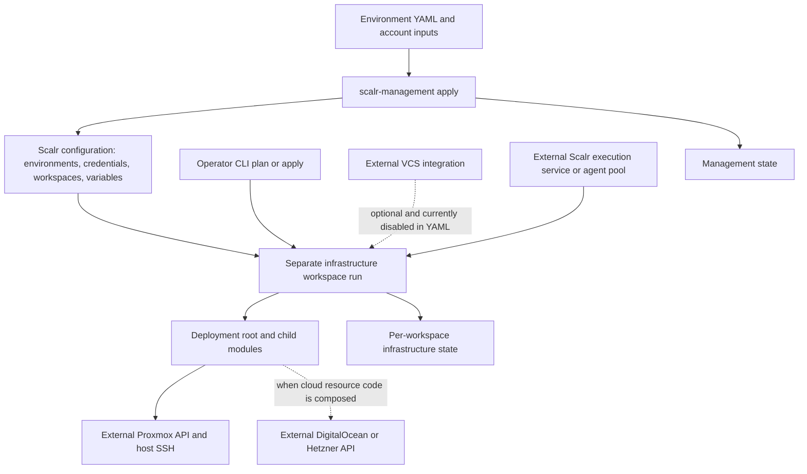

# System ownership and practical source map

This repository has **two infrastructure-as-code layers**, not one end-to-end application platform:

1. **Account management:** `scalr-management/` uses the Scalr provider to create environments, provider configurations, workspaces, and variables.
2. **Infrastructure execution:** deployment roots and examples use infrastructure providers and child modules to manage resources in Proxmox or cloud APIs. A Scalr workspace has its own infrastructure state; creating the workspace is not the same operation as applying its infrastructure configuration.

The strongest active deployment path is Proxmox VM template creation. Many other deployment directories are mostly commented examples with locals and summary outputs, not running services. Read executable HCL before relying on a directory name or README description.

## Control flow and state ownership

*Account management configures Scalr; separately queued workspace runs own infrastructure changes and infrastructure state. Cloud deployment resources are mostly scaffolds today.*

`scalr-management/main.tf` documents local bootstrap with `tofu init`, `tofu plan`, and `tofu apply`; its remote backend example is commented out. In contrast, [`deployments/homelab/templates/backend.tf`](../../deployments/homelab/templates/backend.tf) has an **active** remote backend targeting `the-mothership.scalr.io`, organization `homelab`, workspace `vm-templates-nexus`. Its documented CLI workflow queues remote execution and stores state in Scalr. Do not assume the same checkout automatically selects Matrix or Quantum merely because their workspace definitions exist.

The environment YAML currently declares remote execution and `auto_apply: false` throughout. All workspace `vcs_repo` blocks are commented out. Recorded comments explain the switch to CLI-driven execution as avoiding runs during debugging. Consequently, the push-triggered workflow described in [`deployments/README.md`](../../deployments/README.md) is not the current YAML-configured workflow. CLI-driven submission and remote execution are compatible: “CLI-driven” does not mean the provider operations run locally.

For setup and operations, continue with [Quickstart](../quickstart.md), [Scalr configuration](../concepts/scalr-configuration.md), and [Provision Proxmox](../workflows/provision-proxmox.md).

## Account configuration: the composition layer

[`locals.tf`](../../scalr-management/locals.tf) loads `*.yaml` from the configured environment data path, keys environments by name, and flattens workspace definitions into `environment-name/workspace-name` keys. Defaults include `iac_platform = "opentofu"`, remote execution, and disabled auto-apply. `working_directory` falls back to the legacy `vcs_repo.path`; when VCS is enabled, trigger patterns take priority over prefixes, with the working directory as the default prefix. There is no automatic dependency-aware shared-module trigger mechanism here.

[`provider-configurations.tf`](../../scalr-management/provider-configurations.tf) creates `proxmox-<cluster>` configurations from cluster inputs and optional DigitalOcean, Hetzner, and Infisical configurations from supplied credentials. Workspace-specific `provider_configs` replace environment defaults. Unknown configuration names are filtered out rather than causing an attachment to be created. Explicit workspace attachments have no alias; inherited Proxmox defaults use cluster aliases.

[`workspaces.tf`](../../scalr-management/workspaces.tf) materializes those workspaces, Terraform variables, shell variables, hooks, provider attachments, and optional agent-pool selection. It **looks up** an existing VCS provider and agent pool; it does not install agents or create a GitHub service. It also injects Proxmox endpoint, username, and password variables using the first attached Proxmox configuration it finds. This makes a single-cluster workspace clearer than relying on several attachments for an unaliased provider.

The current homelab YAML defines three template workspaces—`vm-templates-matrix`, `vm-templates-nexus`, and `vm-templates-quantum`—each selecting one cluster while sharing the template root. Cloud YAML has no default provider configurations and currently supplies no workspace-specific attachments; the existence of an account-level cloud credential configuration alone does not imply that every cloud workspace consumes it.

## Implemented domains versus scaffolding

| Area | What the source actually does | Practical consequence |
| --- | --- | --- |
| Template deployment | The template root actively calls `./ubuntu-24-cloudinit`; the Ubuntu 22.04 call is commented out as temporarily disabled for testing. The active child uploads a cloud-init snippet and calls the private VM registry module. | This is an actual resource-producing composition path, not just a plan for future work. |
| Other deployment roots | Single VMs, LXC, Kubernetes, Vault, Nomad/Consul, DigitalOcean droplets/Spaces, Hetzner instances/networking, and VPN roots contain commented resource examples or placeholder configuration. | Outputs such as VM counts or cluster summaries report inputs, not proof of provisioned resources or installed services. |
| Standalone VM module | `terraform-bgp-vm/` manages a Proxmox VM, optional image download, full cloning, disks, networking, and cloud-init. | Use it for local VM/template implementation changes; read its lifecycle rules before expecting every change to reconcile. |
| Standalone LXC module | `terraform-bgp-lxc/` manages a Proxmox container with OS template, initialization, networking, CPU/memory/storage, optional mounts, and startup settings. | This is implemented container provisioning, distinct from the commented LXC deployment example. |
| Cloud modules | DigitalOcean droplet and Hetzner server HCL contain active but hardcoded example resources: `web-1` in `nyc2` and Debian `node1`, respectively. | They are not yet general-purpose, parameterized deployment interfaces. |
| DigitalOcean firewall | Its `droplet_ids` directly references `digitalocean_droplet.web.id`, which is not declared in the firewall module directory. | A sibling module's resource is not in scope. Introduce an input/output interface or place resources in the same module before treating it as reusable. |
| Shared modules | Backup, monitoring, security, and shared cloud compute contain comments only. | There is no shared backup, observability, security, or compute service implemented by these placeholders. |

### Two VM module consumption paths

The distinction matters when deciding where to fix a bug:

- The five roots under `examples/` use `source = "../../terraform-bgp-vm"`. These consume **local module code**. The MicroK8s example uses `for_each` over node definitions directly, not a separate cluster module; it provisions VMs and does not install or join a MicroK8s cluster.
- Both template child directories use `source = "the-mothership.scalr.io/proxmox/vm/bgp"` and `version = "1.0.1"`. The Ubuntu 24.04 child is currently reached by the root; Ubuntu 22.04 is not. Editing `terraform-bgp-vm/` does **not** update the published registry artifact. Publish/select an appropriate artifact deliberately, or change the consumer source explicitly.

The active template child uploads custom user-data, passes the resulting file ID into the registry module, supplies an image URL and storage settings, and sets template startup off. The cloud-image datastore must be file-based, not block storage such as `local-lvm`. The root provider explicitly configures API credentials and SSH settings from variables; comments saying values are injected are not a reason to ignore those assignments. Template image operations require host SSH as well as API connectivity. See [Authentication and connectivity](../integrations/authentication-and-connectivity.md).

For the local VM module, templates are forcibly stopped and excluded from boot startup. Preconditions require clone/image source settings and EFI storage for `ovmf`, and reject simultaneous `vm_init.user` and `vm_user_data`. Its lifecycle ignores cloud-init user-account changes and template conversion changes. These are deliberate reconciliation limits, not evidence that edits were applied. See [Proxmox module contracts](../concepts/proxmox-module-contracts.md) for the detailed contract.

## Task-oriented source map

| If you need to… | Start here |
| --- | --- |
| Add or change a Scalr workspace, provider attachment, variable, or hook | [`scalr-management/data/environments/`](../../scalr-management/data/environments/) and the transformation/resource code in [`scalr-management/`](../../scalr-management/) |
| Change the active template deployment or its remote state destination | [`deployments/homelab/templates/`](../../deployments/homelab/templates/): root call, backend, provider, variables, then the Ubuntu child |
| Implement a currently scaffolded workload | Relevant root under [`deployments/`](../../deployments/); confirm which resource blocks are uncommented before planning |
| Change local Proxmox provisioning behavior | [`terraform-bgp-vm/`](../../terraform-bgp-vm/) or [`terraform-bgp-lxc/`](../../terraform-bgp-lxc/), including variables and outputs |
| Turn cloud examples into reusable interfaces | [`modules/cloud/`](../../modules/cloud/); repair firewall composition rather than copying its sibling reference |
| Try local module composition patterns | [`examples/`](../../examples/): single clone, file/URL templates, custom cloud-init, or multi-VM `for_each` |
| Automate deployment or migration | [`scripts/`](../../scripts/) is only a starting point: all three shell files contain a shebang and a comment, not automation |
| Add regression coverage | [`tests/unit/`](../../tests/unit/), [`tests/integration/`](../../tests/integration/), and [`tests/terratest/`](../../tests/terratest/) document intended test styles but contain README placeholders, not executable tests |
| Check developer tooling | [`.mise.toml`](../../.mise.toml) defines tool versions and formatting, validation, documentation, lint, and changelog tasks; check their working directories before use |

The committed [`.mise.toml`](../../.mise.toml) requires mise `2024.9.5` or newer, enables automatic tool installation, and pins `terraform-docs = "0.22.0"`, `tflint = "0.62.0"`, and `git-cliff = "2.13.1"`. It does not declare an OpenTofu tool; [`.opentofu-version`](../../.opentofu-version) separately records `1.10.0`. The `tflint` and `tflint-fix` tasks initialize TFLint and run recursively, with only the latter adding `--fix`; the bare `lint` task has no configured command or dependencies. Do not treat it as an aggregate validation gate. For practical checks, see [Local validation](../testing/local-validation.md).

No automated regression evidence is supplied by the placeholder test directories. Focus new coverage on YAML-to-workspace transformations, provider selection, VM source/precondition combinations, template lifecycle behavior, and the firewall interface once implemented. Static inspection here did not run plans, applies, or provider-backed tests.

## External ownership and evolution

**Integration boundaries:** Proxmox owns the virtualization hosts, storage, API, and SSH service; Scalr owns workspace execution/state services and its private registry; cloud providers own their APIs. VCS authentication and repositories, deployed agents, and network reachability are external prerequisites. Downstream cluster bootstrapping and application delivery are separate responsibilities. This repository does not implement Omni, Talos, GitOps, AWS infrastructure, or a functioning MicroK8s installer; names and aspirational comments do not establish those capabilities.

The root [changelog](../../CHANGELOG.md) records the infrastructure foundation and move from an `iac-homelab` subdirectory to root-level modules. The [VM changelog](../../terraform-bgp-vm/CHANGELOG.md) records the 1.0.1 lifecycle fix adding `template` to `ignore_changes` to avoid inconsistent-result errors; current local HCL retains that rule. These records and inline comments establish documented evolution, not a reconstructed commit narrative: Git history inspection is unavailable through the supplied tools.

Treat the [documentation audit](../../docs/audits/AUDIT_REPORT_2026-04-28.md) as a historical lead, not executable truth. Its disabled-VCS and placeholder-test findings match current files. Its duplicate-`tflint`/`pre-commit` tooling observation does **not** match the current `.mise.toml`, which no longer contains those duplicates. Current formatting, validation, and docs-check tasks still set `dir = "terraform"`, while the source roots are now at repository top level; adjust or run checks against the intended root rather than assuming those task paths work.
