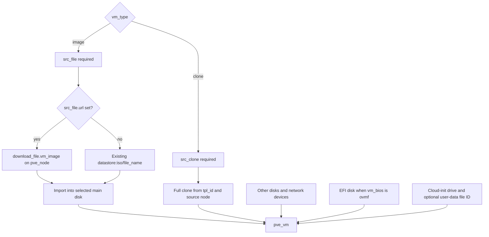

# VM and LXC module contracts

The two reusable modules own different Proxmox resources: `terraform-bgp-vm` manages a VM and optionally downloads its source image; `terraform-bgp-lxc` manages a container from an existing template. They are not interchangeable interfaces. In particular, LXC does **not** inherit the VM module's image download, EFI, cloud-init user-data, output fallback, or lifecycle rules.

Use the [system map](../architecture/system-map.md) for placement in the wider repository and [provisioning workflow](../workflows/provision-proxmox.md) for deployment steps. The authoritative interface references are the [VM variables](../../terraform-bgp-vm/variables.tf), [VM outputs](../../terraform-bgp-vm/outputs.tf), [LXC variables](../../terraform-bgp-lxc/variables.tf), and [LXC outputs](../../terraform-bgp-lxc/outputs.tf); this page explains their behavioral contract rather than duplicating the generated reference.

## VM creation: image import or full clone

`vm_type` must be `image` or `clone`. Both paths converge on `proxmox_virtual_environment_vm.pve_vm` in [the implementation](../../terraform-bgp-vm/main.tf).

*Figure 1. VM resource dependencies: URL downloads are owned by the module, while existing images, clone sources, and custom user-data files must already exist or be supplied by caller-managed resources.*

### Image path

- `src_file` is required by a resource precondition. With a non-null `url`, the module creates one download resource with `content_type = "iso"`, on `pve_node`, using the specified datastore and filename. A checksum is optional; the checksum algorithm is passed only when a checksum is supplied (its input default is `sha256`).
- Without a URL, the main disk references `${src_file.datastore_id}:iso/${src_file.file_name}` directly. The module does not upload or verify an existing file. `src_file.file_format` is declared but is not consumed by this resource construction; disk format comes from `vm_disk`.
- At most one disk can have `main_disk = true`. If none is marked, the fallback is `keys(var.vm_disk)[0]`: the first map key in Terraform ordering, not the first entry a human happened to write. An empty disk map has no useful fallback and is not explicitly rejected by a non-empty validation. Keep at least one disk and mark the import target explicitly.
- Only that selected disk receives `file_id`; remaining disks are configured without an imported image. Changing keys or the main flag can therefore change which disk receives the image.

### Clone path

`src_clone` is required by a precondition. The clone is always **full**, with its target datastore from `src_clone.datastore_id`. The source node defaults to `pve_node` if `src_clone.node_name` is null; `tpl_id` identifies the source. No image download is created. Every `vm_disk` entry is rendered as a disk without an image `file_id`; `main_disk` does not select a clone source.

Although source-variable descriptions say the source objects cannot be used together, implementation preconditions require only the object appropriate to the selected mode. They do not reject an unused second source object. Callers should still supply only the relevant one to avoid ambiguous intent.

### Hardware and EFI invariants

`bios`, `machine`, and `scsi_hardware` are assigned only for image mode; they are null for clones. **EFI is different:** both the EFI block condition and its precondition depend on `vm_bios == "ovmf"`, regardless of creation mode. Since `ovmf` is the default and `vm_efi_disk` defaults to null, clone callers also need an EFI configuration unless they change `vm_bios`. Do not assume cloning bypasses that check.

Useful baseline defaults are host CPU with two cores, 2048 MiB dedicated memory, `q35`, and `virtio-scsi-single`. In resource construction, null floating memory is replaced with dedicated memory. The agent defaults to enabled with a `15m` timeout and trim enabled; RNG and serial socket devices are also enabled by default and can be omitted with null inputs. Consult [DEFAULTS.md](../../terraform-bgp-vm/DEFAULTS.md) for guidance, but use `main.tf` for actual behavior where comments or guidance differ.

## Networking and initialization are coupled

`vm_net_ifaces` is iterated twice: once for `network_device` blocks and once for cloud-init `ip_config` blocks. Device configuration includes bridge, MAC, VLAN, firewall, model, MTU, and rate limit. `enabled = false` sets `disconnected = true`; it does not remove that interface's IP configuration. Each cloud-init entry passes `ipv4_addr` and optional gateway. DNS comes separately from `vm_init.dns`.

The module does not explicitly assign the map keys as provider NIC indices: both dynamic block sets follow the same map iteration order. Treat key changes and multi-digit names carefully, rather than assuming arbitrary map naming preserves positional NIC identity. `vm_init` is required even for clones and creates the initialization drive on its datastore, defaulting to interface `ide2`.

There are two mutually exclusive account modes:

| Mode | Caller input | Module behavior |
|---|---|---|
| Structured user account | `vm_init.user` set, `vm_user_data` null | Emits username, password, and public-key **contents** as `user_account` |
| Custom user-data | `vm_init.user` null, `vm_user_data` set | Passes the string as `user_data_file_id`, not inline YAML |

Both null is permitted; both non-null fails a resource precondition. The module does not upload custom user-data itself. The [Ubuntu template caller](../../deployments/homelab/templates/ubuntu-24-cloudinit/main.tf) demonstrates a caller-owned snippets upload and passes its resulting file ID into the module, creating the dependency through that reference.

Validation covers creation mode, BIOS/machine/SCSI/OS/display choices, disk-key conventions, at most one main disk, discard values, NIC-key conventions, and initialization-drive naming. The key checks use `can(regex(...))` with unanchored patterns; they are not complete schema or Proxmox compatibility validation. There is no general IPv4/CIDR, bridge existence, disk-capacity, or reachability validation in these inputs. See [authentication and connectivity](../integrations/authentication-and-connectivity.md) for the execution boundary.

## VM lifecycle: deliberate ignored changes, not deletion protection

The VM lifecycle ignores `initialization[0].user_account` and `template`. Account configuration is applied at creation, but later structured username, password, or key changes are not reconciled through that block. In particular, changing SSH keys in the caller is not an assured key-rotation mechanism. This ignore does not cover the whole initialization block or custom `user_data_file_id`.

Ignoring `template` is a recorded workaround: the [VM 1.0.1 changelog](../../terraform-bgp-vm/CHANGELOG.md) says it was added to prevent an inconsistent-result error. Consequently, editing `vm_template` is not a reliable way to reconcile conversion of an existing VM. Inspect the resource and state before assuming conversion occurred.

For desired templates, `started` and `on_boot` are forced false even if `vm_start` requests true; startup order and delays are still emitted. Non-template VMs use `vm_start.on_deploy` and `vm_start.on_boot`, both true by default.

There is **no blanket `prevent_destroy` guarantee**: the VM resource declares neither `prevent_destroy` nor `create_before_destroy`, and LXC declares no lifecycle block. Do not interpret the lifecycle comment about static arguments as a working caller input for deletion protection. Review replacement/destroy plans explicitly; see [state and troubleshooting](../operations/state-and-troubleshooting.md).

## VM outputs: convenience is not readiness

The [output implementation](../../terraform-bgp-vm/outputs.tf) exports resource ID, name, node, guest-agent IPv4/IPv6 arrays, MAC addresses, `primary_ip`, and a full resource object.

`primary_ip` is calculated exactly as follows:

1. Take the first value of `vm_net_ifaces`, split its configured `ipv4_addr` at `/`, and take the first segment; use null if that expression fails.
2. Flatten `pve_vm.ipv4_addresses`, falling back to an empty list if the expression fails.
3. Filter out only `""`, `"127.0.0.1"`, and null. Select the first remaining address in provider-returned order.
4. Use `coalesce(detected_primary_ip, configured_primary_ip, "N/A")`.

This is not a routability test, a match to `net0`, or a cloud-init completion check. Other loopback addresses and link-local addresses are not explicitly filtered. A configured string of `dhcp` becomes the literal fallback `dhcp`; it is **not evidence of an assigned usable address**. Likewise a configured static fallback is desired configuration, not proof that the guest accepted it. Keep raw agent arrays when diagnosis requires the distinction.

`vm_resource` is explicitly `sensitive = true`. Preserve that boundary in wrappers and diagnostics instead of exposing the full object through an ordinary output. The focused identity/address outputs are not marked sensitive by this module.

## LXC: a separate, smaller contract

The [container implementation](../../terraform-bgp-lxc/main.tf) creates one `proxmox_virtual_environment_container.lxc`:

- **Privilege and template:** `unprivileged` defaults to true and is passed directly. `os_template` is a required existing template file ID; there is no download or clone resource. `os_type` defaults to `unmanaged` and is validated against the supported list in the variables file.
- **Account material:** `user_ssh_key_public` is a path, despite its name. The module evaluates `file(var.user_ssh_key_public)` on the Terraform/OpenTofu execution host and wraps its contents in a one-element key list; null yields an empty list. Remote runners therefore need that file available locally. The variable's validation merely rejects a path string matching `PRIVATE` case-insensitively; it does not inspect the file contents for a private key. The path and password inputs are marked sensitive.
- **Networking:** one `network_interface` uses `vnic_name` (`eth0`), `vnic_bridge` (`vmbr0`), and optional VLAN. The `ipv4` list produces dynamic IPv4 blocks inside one `ip_config`, passing addresses and gateways directly. Its default is one `dhcp` entry with null gateway. This is not the VM's per-interface map or guest-agent address mechanism.
- **Storage and sizing:** one root disk defaults to `local-lvm`, size 8. Optional `mountpoint` entries pass volume, size, container path, backup, and read-only fields; backup and read-only default false. CPU defaults to one core, dedicated memory and swap each to 512 MiB.
- **Startup:** `start_on_create` defaults true; `start_on_boot` defaults false. A `startup` block is emitted only when boot startup is enabled, with order default 1 and nullable startup/shutdown delays. There is no VM-style template startup suppression.

LXC outputs are only `id` and the first network interface's `mac_address`. There is no `primary_ip`, raw IP output, or sensitive full-resource output. Do not introduce dependencies on VM-only output semantics in a wrapper shared with containers.

## Composition and version boundaries

The [single-VM example](../../examples/single-vm/main.tf) composes a local clone module with optional second NIC, a primary gateway, EFI storage, and structured cloud-init user keys. The [MicroK8s example](../../examples/microk8s-cluster/main.tf) uses the same module with `for_each = local.nodes`, not a separate cluster resource:

- Stable node keys (`microk8s-1` through `microk8s-3`) identify module instances.
- VM IDs use offsets `dev = 2000`, `staging = 3000`, `prod = 4000`, plus 101–103.
- Explicit MACs such as `02:50:00:30:01:01` keep NIC identity deterministic; optional secondary NICs use another fixed set.

These offsets separate ID ranges, but the shown names, IPs, and MACs are not environment-offset. Copying the example into multiple environments on shared networks requires a wider uniqueness plan. The HCL provisions VMs; its name and tags are not evidence that MicroK8s is installed or that a Kubernetes cluster has formed.

Keep three version decisions separate:

| Boundary | Repository example |
|---|---|
| Module minimum compatibility | VM requires Terraform `>= 1.0`; LXC requires `>=1.5.0`; both require `bpg/proxmox >= 0.84.1` |
| Deployment provider selection | [Template versions](../../deployments/homelab/templates/versions.tf) selects `~> 0.89.0` and Terraform `>= 1.8`; its comment still mentions 0.84.x, so read the expression, not the comment |
| Published module release selection | Ubuntu template caller selects private-registry source `the-mothership.scalr.io/proxmox/vm/bgp`, version `1.0.1`; the examples use a relative local source instead |

A provider constraint is not a module release, and a locally edited module is not automatically the code consumed by the pinned registry caller.

## Safe change review

The repository's unit, integration, and Terratest directories currently contain placeholder READMEs rather than executable contract tests. For validation commands and environment setup, use [local validation](../testing/local-validation.md). Prioritize these checks when changing callers or module code:

- Plan image-with-URL, existing-image, and full-clone paths separately; verify dependencies and the selected import disk.
- Exercise missing source/EFI inputs, conflicting user modes, multiple main disks, and key convention checks.
- Compare plans for account edits, template changes, and startup flags against the intentional lifecycle exceptions.
- Check multi-NIC ordering and output behavior with absent agent data, `dhcp`, static addresses, and non-primary agent addresses.
- For LXC, verify runner-local public-key availability, existing template resolution, mount-point flags, and startup-block presence independently of VM behavior.

These are recommended regression checks, not claims of existing automated coverage.
