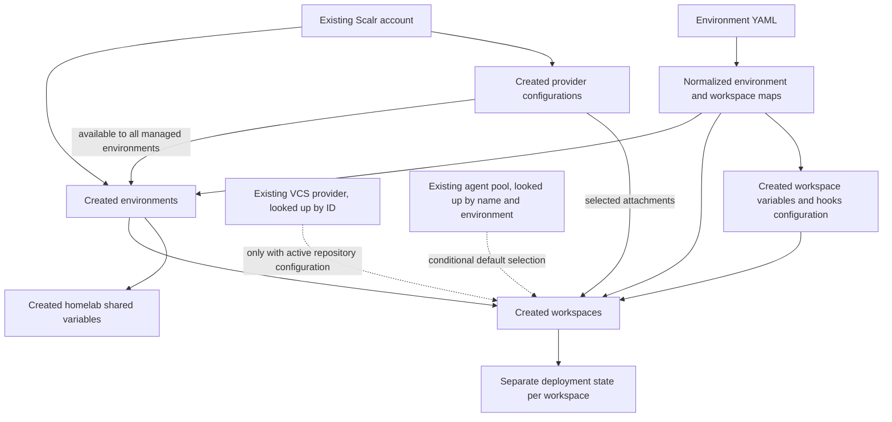

# Scalr entities and YAML configuration model

The `scalr-management` root manages **Scalr's configuration**, not the infrastructure inside each deployment workspace. An existing account supplies the scope; this root creates environments, account-scoped provider configurations, workspaces, and variables. Each deployment workspace has its own state and may be CLI-driven or VCS-backed. The management root's remote backend is only a commented example, not an enabled backend. See the [system map](../architecture/system-map.md) for the wider infrastructure boundary.

## Entity relationships

*Figure 1. Created Scalr entities versus pre-existing account, VCS provider, and agent pool dependencies. Hooks are nested workspace configuration, not independent resources; a YAML agent-pool ID can also bypass the default lookup.*

The account itself, VCS integration, and agent pool are not provisioned here. `account_id` must start with `acc-`. Provider configurations hold reusable credentials/settings and are linked to every managed environment through their `environments` property; that availability is distinct from selecting attachments on a workspace.

Sources: [environment resources](../../scalr-management/environments.tf), [provider resources](../../scalr-management/provider-configurations.tf), [workspace resources and lookups](../../scalr-management/workspaces.tf), [management entrypoint](../../scalr-management/main.tf).

## From YAML to resource identities

The loading pipeline in [locals.tf](../../scalr-management/locals.tf) is:

1. `fileset(".", "${var.environments_data_path}/*.yaml")` discovers YAML files, with `environments_data_path` defaulting to `./data/environments`.
2. `yamldecode(file(env_file))` decodes each file; `flatten` collects the environment records.
3. `local.environments` keys records by `env.name`, retaining `default_provider_configs`, `policy_groups`, and `workspaces`, each defaulting to `[]`.
4. `local.workspaces_flat` merges workspace records under **`environment-name/workspace-name`**, adding `environment_name`.
5. `local.workspaces` normalizes fields, resolves provider names to resource IDs, and supplies the `for_each` map for `scalr_workspace.workspaces`. Environments use `local.environments` directly as their `for_each` map.

File names are discovery inputs, not resource identity. Renaming `homelab.yaml` without changing its contents does not change those keys. Renaming an environment changes its environment key and every descendant workspace key; moving or renaming a workspace changes its workspace key. Without an explicit state migration, these are removal/addition identities in an OpenTofu plan, not a guaranteed in-place rename. Removing a record or a discovered file removes the corresponding desired resources. Review destruction and state consequences before applying; see [state and troubleshooting](../operations/state-and-troubleshooting.md).

Names must be unique among environments and among workspaces within one environment: the map comprehensions do not implement duplicate-name reconciliation. Workspace-variable maps add another segment, `environment/workspace/variable-key`, so variable-key changes also change resource addresses. Proxmox provider configurations instead use the cluster-map key from `var.proxmox_clusters`.

## Normalized workspace fields versus applied fields

| Input | Normalization and application |
|---|---|
| `name`, environment membership | Determine workspace identity and `environment_id`. |
| `auto_apply` | Defaults to `false`; assigned to the resource. |
| `execution_mode` | Defaults to `remote`; assigned to the resource. |
| `iac_platform` | Defaults to `opentofu`; assigned independently of the version field. |
| `terraform_version` | Defaults to `null`; passed to the workspace. |
| `var_files` | Defaults to `[]`; passed to the workspace. |
| `working_directory` | Uses `try(ws.working_directory, try(ws.vcs_repo.path, null))`; the deprecated `vcs_repo.path` remains a compatibility fallback. This is an absent-field fallback, not explicit-null coalescing. |
| `description` | Normalized to `""`, but not assigned in `scalr_workspace.workspaces`. |
| `run_operation_mode` | Normalized to `null`, but its resource assignment is commented out. Setting YAML alone does not apply it. |
| `hooks` | Defaults to `null`; when present, emits a nested block with optional `pre_plan`, `post_plan`, `pre_apply`, and `post_apply`. |

The checked-in [homelab YAML](../../scalr-management/data/environments/homelab.yaml) defines nine workspaces and [cloud YAML](../../scalr-management/data/environments/cloud.yaml) defines five. **All fourteen configure remote execution, `auto_apply: false`, and `terraform_version: "1.10.0"`; the platform defaults to OpenTofu. All current VCS blocks are commented out.** There are no active `working_directory` entries in these files, so their normalized working directories are `null`. The paths in comments do not establish current working directories or active repository bindings.

## Provider configuration creation and attachment

Provider resources are driven by Terraform input variables, **not by `provider-configs.yaml`**. The additional YAML-driven provider-resource block is commented out. The active resources are:

- One `bpg/proxmox` custom configuration named `proxmox-<cluster>` per `var.proxmox_clusters` entry.
- `digitalocean` when `digitalocean_token` is non-null, with optional Spaces keys.
- `hetzner` when `hetzner_token` is non-null.
- `infisical` when `infisical_client_id` is non-null, using its host and client credentials.

All set `export_shell_variables = false`. Proxmox arguments include the endpoint and conditional TLS, SSH, and authentication settings. Cluster validation requires an API token **or** both username and password; it does not enforce mutual exclusion. Sensitive arguments are marked on the provider configurations. See [authentication and connectivity](../integrations/authentication-and-connectivity.md) for credential and SSH concerns.

`local.provider_config_map` maps only created configuration names to IDs. Attachment resolution follows these exact rules:

1. A non-null workspace `provider_configs` list **replaces**, rather than extends, the environment defaults. An empty list explicitly attaches nothing.
2. Otherwise, the workspace inherits `default_provider_configs` from its environment.
3. Both branches filter out unknown names. A typo or an optional provider not created by its input variables can therefore yield missing attachments without a direct missing-name error.
4. Every explicit workspace attachment has `alias = null`, even if the explicit list contains several Proxmox configurations. Inherited names starting with `proxmox-` receive the suffix as their alias; other inherited providers are unaliased. The implementation does not count providers before assigning inherited aliases.

Homelab defaults list `proxmox-nexus`, `proxmox-matrix`, and `proxmox-quantum` in that order. Its three `vm-templates-*` workspaces override this with one matching, unaliased cluster attachment. Cloud has empty defaults and no workspace provider overrides, so its current YAML selects **no provider attachments**, despite the provider names in workspace names.

Environment-level `default_provider_configurations` and `policy_groups` assignments are commented out in [environments.tf](../../scalr-management/environments.tf). `policy_groups` is loaded but not applied. Provider-default inheritance is implemented in locals and materialized as workspace attachment blocks, not as a native Scalr environment-default property.

## Variables and credential selection

There are three separate paths, not one generic environment-YAML variable hierarchy:

- **Shared homelab variables:** when an environment named exactly `homelab` exists, four environment-scoped `scalr_variable` resources provide `proxmox_ssh_key` from the input variable, `proxmox_ssh_username = "terraform"`, `proxmox_insecure = "true"`, and `proxmox_ssh_agent = "false"`. Only the key is sensitive. Arbitrary environment-level YAML variables are not loaded by the environment transformation.
- **Workspace `variables`:** each record creates a variable keyed by workspace plus variable key. Defaults are `category: terraform`, empty description, and `sensitive`, `final`, and `hcl` all false. YAML must supply `key` and `value`.
- **Workspace `environment_variables`:** each record creates a `category = "shell"` variable, with description, sensitivity, and finality options. This resource is active: documentation statements that shell variables are “not used” describe an authentication convention, **not an unsupported capability**.

In addition, `workspace_proxmox_credentials` reverse-maps attachment IDs back to configuration names, filters to `proxmox-` names, and selects the **first** matching attachment. Workspaces with a match receive generated Terraform variables `proxmox_endpoint`, `proxmox_username`, and `proxmox_password` from that cluster in `var.proxmox_clusters`; username and password are sensitive, endpoint is not. These resources are keyed by the workspace key, independently of YAML variable resources.

This generated-variable path is not one credential triplet per alias. With the current inherited homelab ordering and all three configurations available, it selects Nexus; explicit template overrides select their own cluster. Changing attachment order can change these variable values without changing the workspace key. API-token authentication is supported in provider configurations, but the generated username/password resources still read the optional username/password fields; there is no token-to-password fallback. Avoid manually defining the same generated keys in YAML: those would be separate managed variable resources targeting the same workspace/key.

Sources: [variable and credential resources](../../scalr-management/workspaces.tf), [shared variables](../../scalr-management/environments.tf), [input schema and validation](../../scalr-management/variables.tf). The [architecture notes](../../scalr-management/docs/ARCHITECTURE.md) explain the intended distinction between provider arguments and Terraform variables available to deployment code.

## Optional VCS and agent selection

VCS support remains implemented even though the checked-in repositories are disabled. A workspace needs both a non-null `vcs_repo` and non-null `var.vcs_provider_id` to emit its VCS block and provider ID. The provider is looked up in the account by ID; it is not created. Merely setting `vcs_provider_id` does not restore commented YAML repositories.

For an enabled `vcs_repo`, `identifier` is required and `branch` defaults to `main`. Trigger precedence is:

1. Non-null `trigger_patterns` wins and forces `trigger_prefixes` to null.
2. Otherwise explicit non-null `trigger_prefixes` wins.
3. Otherwise the effective working directory becomes a one-element prefix list, if available; without a directory, prefixes remain null.

Patterns support the intended gitignore-style inclusion/exclusion capability; directory fallback supports the deprecated `vcs_repo.path`. These are supported configuration mechanisms, not evidence that current workspaces have active triggers.

Agent selection is also input-dependent, not a hardcoded deployed agent identity. A non-null YAML `agent_pool_id` wins. Otherwise, both `agent_pool_name` and `agent_pool_environment` must be supplied, and only workspaces in that named environment receive the looked-up pool. Other workspaces receive null. The lookup itself references a managed environment by name, so an absent environment key is an invalid dependency, not a fallback. Both input defaults are null; establish actual supplied variables before concluding which pool a deployment uses.

## Outputs and safe changes

[outputs.tf](../../scalr-management/outputs.tf) exposes environment names to IDs, composite workspace keys to IDs/details, and workspaces grouped by environment. Provider maps and `summary` are marked sensitive; the summary includes resource counts and configured cluster/provider names. These outputs reflect managed resource maps, not the commented examples in YAML.

For an extension, add environment/workspace YAML for topology, add cluster input entries for new Proxmox providers, or extend the explicit provider resources **and** `provider_config_map` for another provider family. Adding policy names or `run_operation_mode` to YAML alone does not activate commented assignments.

Use the management entrypoint's `tofu init && tofu plan`, then inspect the plan before `tofu apply`. Focus review on composite-key removals/additions, filtered provider names, alias changes, first-provider credential selection, and conditional VCS/agent attachments. The [manage Scalr workflow](../workflows/manage-scalr.md) covers operational steps; comments and architecture intent should not substitute for the evaluated plan.
