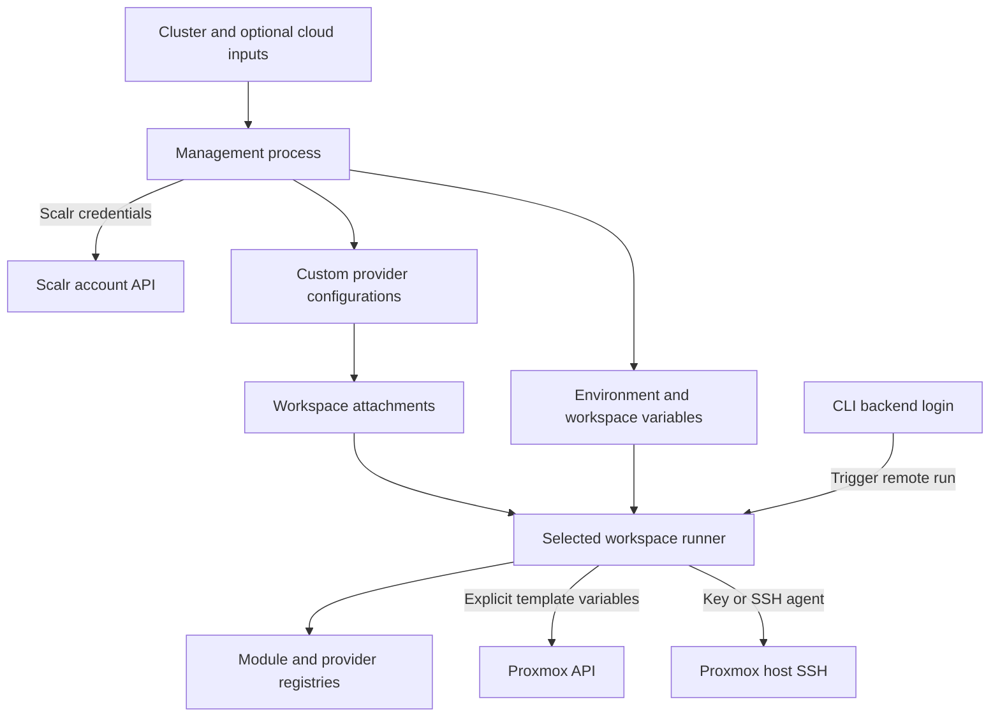

# Authentication, agents, and connectivity boundaries

A successful Scalr login does not grant Proxmox access, and a successful Proxmox API login does not establish host SSH access. There are three separate boundaries: **managing the Scalr account**, **starting or fetching a workspace configuration**, and **executing that configuration against infrastructure**. The machine executing providers—not necessarily the laptop issuing `tofu plan`—needs the runtime credentials and network paths.

## Credential sources and execution contexts

| Boundary | Credential source and propagation | Execution context and prerequisite |
| --- | --- | --- |
| Scalr account management | The empty `provider "scalr"` in `scalr-management/main.tf` relies on `SCALR_HOSTNAME` and `SCALR_TOKEN`, or CLI credentials as described there. `account_id` selects the account; it is not an API token. | The process applying `scalr-management` must authenticate to Scalr and have permission to manage environments, provider configurations, variables, and workspaces. Its remote backend is commented out by default. |
| CLI remote backend | `tofu login the-mothership.scalr.io` establishes CLI credentials for the backend hostname. The template root's active remote backend selects organization `homelab` and workspace `vm-templates-nexus`. | The CLI initiates the workflow and accesses remote state/run services. For remote execution, providers run on the workspace runner rather than acquiring access through the laptop's network. |
| Private module registry | The Ubuntu template requests `the-mothership.scalr.io/proxmox/vm/bgp`, version `1.0.1`. Registry access is a separate requirement from Proxmox authentication; arrange credentials for the registry hostname in the context performing initialization. | A local `tofu init` and remote workspace initialization must each be able to resolve and access the module registry as applicable. Do not assume a laptop login populates an agent's credential store. |
| Local Proxmox examples | `examples/single-vm/provider.tf` and `examples/template-from-url/provider.tf` set endpoint and TLS policy explicitly, leaving API authentication to `PROXMOX_VE_USERNAME` plus `PROXMOX_VE_PASSWORD`, or `PROXMOX_VE_API_TOKEN`. | Set these in the actual local execution environment. The template-from-URL example also enables the local SSH agent and takes `ssh_username` separately. |
| Scalr custom Proxmox provider arguments | Management input `proxmox_clusters` produces an account-scoped `proxmox-<cluster>` configuration for `bpg/proxmox`, linked to all managed environments. Non-null token, username, password, TLS, and SSH settings become provider arguments. `export_shell_variables = false`. | Workspace attachments select these configurations. They are not exports of `PROXMOX_VE_*` shell variables. |
| Generated Terraform credentials | Management finds the first attached known provider whose name starts with `proxmox-`, then creates Terraform-category `proxmox_endpoint`, `proxmox_username`, and `proxmox_password` variables from that cluster. Username and password are marked sensitive. | The template root explicitly reads these variables for provider authentication. No corresponding generated token variable exists. |
| Host SSH key or agent | Local URL-template provisioning uses `ssh.agent = true`. Custom configurations inject `ssh.private_key` when `ssh_agent == false` and `proxmox_ssh_key` is non-null. The homelab environment also receives a sensitive Terraform-category `proxmox_ssh_key`, SSH username `terraform`, and agent setting `false`. | The executing process needs the selected key or a working agent, and the host must authorize that identity. API credentials do not replace SSH credentials. |
| DigitalOcean and Spaces | Non-null `digitalocean_token` creates the custom provider configuration. Optional `digitalocean_spaces_access_key` and `digitalocean_spaces_secret_key` become `spaces_access_key_id` and `spaces_secret_key`. | Attached workspaces need access to the relevant DigitalOcean APIs and, when used, Spaces endpoints. Supplying Spaces keys alone does not create this configuration. |
| Hetzner | Non-null `hetzner_token` creates the `hetznercloud/hcloud` custom configuration with a sensitive `token` argument. | Attach it to the intended workspace and permit Hetzner Cloud API access from the runner. |
| Optional Infisical | Non-null `infisical_client_id` enables the configuration with `host`, `client_id`, and `client_secret`; the host defaults to `https://app.infisical.com`. | The runner needs access to that host and valid machine-identity credentials. This creates a provider configuration, not an automatic secret-fetching layer for every workspace. |

Sources: [management authentication](../../scalr-management/main.tf), [input contract](../../scalr-management/variables.tf), [custom providers](../../scalr-management/provider-configurations.tf), [workspace variables](../../scalr-management/workspaces.tf), [homelab variables](../../scalr-management/environments.tf), and [template backend](../../deployments/homelab/templates/backend.tf).

## Management authentication is not runtime authentication

*Credential flow: management authenticates to configure Scalr; workspace execution consumes attachments and variables to reach infrastructure independently.*

The template provider is **not empty**. Despite comments describing injection, [its actual expressions](../../deployments/homelab/templates/provider.tf) assign `endpoint`, `username`, `password`, and `insecure` from Terraform variables, and assign `ssh.agent`, `ssh.username`, and `ssh.private_key` the same way. Generated workspace credentials therefore do participate in authentication.

### Token support has an end-to-end gap

Management validation accepts a cluster with either a non-null `api_token` **or** both username and password. It does not enforce exclusivity: if all fields are supplied, the custom configuration emits all applicable arguments. This is the custom-provider contract, not proof that every deployment supports token-only operation.

The generated workspace credential path only copies username/password, and the template provider explicitly uses those fields. Its username/password inputs are required, and it has no token expression. A token-only cluster can pass management validation without providing the credentials required by this template path. Before changing authentication modes, update and verify the whole chain—input validation, custom arguments, generated workspace variables, and consuming provider expressions. Do not assume a token in an attached configuration makes the explicit template username/password path disappear.

For workspaces with multiple Proxmox attachments, generation chooses the **first** recognized Proxmox configuration; it does not generate independent credential sets for every alias. YAML workspace `provider_configs` override environment defaults; otherwise management translates defaults into workspace attachments. Unknown configuration names are filtered out. These are application-level attachments: `default_provider_configurations` on the environment resource itself is commented out. See [Scalr configuration](../concepts/scalr-configuration.md).

## Agent lookup and execution placement

[Workspace construction](../../scalr-management/workspaces.tf) looks up an **existing** `scalr_agent_pool` only when both `agent_pool_name` and `agent_pool_environment` are non-null. Lookup uses the account ID and the managed environment ID indexed by that environment name. The name must therefore identify a loaded environment and the pool must already exist in that scope.

Pool selection has explicit precedence:

1. A workspace YAML `agent_pool_id` wins.
2. Otherwise, use the looked-up pool only if the workspace's environment name equals `agent_pool_environment`.
3. Otherwise, leave `agent_pool_id` null.

Workspace `execution_mode` defaults to `remote` through [YAML normalization](../../scalr-management/locals.tf); `local` is also passed through to Scalr. Pool selection and execution mode are distinct settings. This configuration does not install agents or create pools. An agent name mentioned in setup prose is not a resource managed here, nor a guarantee that the selected runner is alive or correctly routed.

For VCS-backed workspaces, an existing Scalr GitHub VCS provider is looked up by `vcs_provider_id`. The `vcs_repo` block and provider attachment are enabled only when both repository configuration and that ID are present. GitHub integration authorization must exist separately; a Proxmox token cannot fetch repository code. CLI-driven workspaces instead need the correct backend selection and uploaded configuration. See [Manage Scalr](../workflows/manage-scalr.md).

## Connectivity and ownership checklist

Validate these paths **from the chosen execution context**, not just from an administrator's workstation:

- **Runner → Scalr:** account-management APIs for management applies; backend/run/state services for CLI workflows; module registry access during initialization.
- **Runner → provider registries:** resolve and download required provider packages, including `bpg/proxmox`. Private module authorization does not replace provider package access.
- **Runner → Proxmox API:** reachable endpoint, correct credentials and API permissions, and compatible TLS trust policy. Host SSH is a second path, not a substitute for the API.
- **Runner → Proxmox host SSH:** reachable host, correct OS username, authorized key or agent, and privileges required for image import and snippet operations. The configured `terraform` username must already exist on the relevant hosts with appropriate permissions for `qm`/`pvesm` operations.
- **Proxmox node → image origin:** URL-based images are requested through `proxmox_virtual_environment_download_file` on the target node. Ensure node-side DNS and egress to the configured image URL, not only runner-side HTTP access. The template defaults use `cloud-images.ubuntu.com`.
- **Runner and node DNS:** resolve Scalr, registries, API hostnames, SSH hosts, and image origins in their respective contexts. Guest DNS settings are different: `dns_servers` is passed into cloud-init, not used to configure the runner's resolver.
- **Optional cloud APIs:** allow the relevant DigitalOcean, Spaces, Hetzner, or configured Infisical endpoints when those providers are actually used.

The [Ubuntu template](../../deployments/homelab/templates/ubuntu-24-cloudinit/main.tf) provisions a snippet upload and a VM template through a module; the [VM module](../../terraform-bgp-vm/main.tf) creates image downloads and VM configuration. They **consume**, rather than create, host storage and networking:

| Must already exist or be configured externally | What this configuration actually sets |
| --- | --- |
| Host bridges, VLAN transport, routing, gateways, and DNS servers | VM NIC bridge/VLAN attributes and cloud-init IP/DNS settings |
| Snippet-capable datastore | Uploaded user-data snippet and its VM reference |
| File-based image storage, such as `local`, supporting the download content | Downloaded image file; block storage such as `local-lvm` is not the cloud-image download destination |
| VM/EFI disk storage | VM disks and EFI disk placement; this may use `local-lvm` independently of image storage |
| Host SSH user, authorized keys, privileges, and SSH service | Provider SSH client settings only |

The template root defaults `proxmox_insecure` to `true`, and management sets a homelab environment variable of the same value. This is the **current configuration**, which skips TLS verification, not a recommendation. Treat certificate trust as an explicit deployment decision rather than using insecure mode as a generic connectivity fix.

## SSH setup and safe verification

Use [SSH key setup guidance](../../scalr-management/SSH_KEY_SETUP.md), but reconcile it with the current HCL:

- Its `ssh-keygen -t ed25519` example generates an OpenSSH-format key; “PEM format (OpenSSH format)” is not a precise equivalence. Verify the provider accepts the chosen key format rather than blindly converting it.
- Its examples showing `ssh_private_key` inside a cluster object do not match the declared cluster schema. Management reads the separate sensitive `proxmox_ssh_key` input and emits `ssh.private_key` conditionally.
- Its shell-category `TF_VAR_proxmox_ssh_key` suggestion and the managed Terraform-category `proxmox_ssh_key` are alternative input mechanisms, not identical Scalr variable keys. Avoid conflicting manual and managed definitions.
- Use a dedicated runtime key when the runner has no SSH agent; do not assume local agent availability is forwarded to a remote run. Test SSH from the runner against every host it will use, with the configured username, before attempting image imports.

Keep private key material, tokens, variable files containing secrets, plans, and state out of documentation and logs. Sensitive markings control display, not the need to secure the management inputs and state. First verify initialization and registry access, then API authentication, then host SSH and permissions, then node-side image download and storage support. A successful plan alone does not prove an image import will succeed during apply.

For provisioning contracts and deeper failure handling, see [Proxmox module contracts](../concepts/proxmox-module-contracts.md), [Provision Proxmox](../workflows/provision-proxmox.md), and [State and troubleshooting](../operations/state-and-troubleshooting.md).
