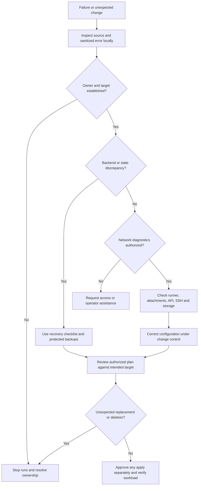

# State safety, recovery limits, and troubleshooting

**Establish the state owner and target cluster before running anything that contacts a backend.** A CLI-driven run is not necessarily local: the template deployment has a remote Scalr backend, and its `tofu plan` executes remotely.

This repository is not a disaster-recovery system. The [shared backup module](../../modules/shared/backup/main.tf) contains only a comment, and [opentofu-migrate.sh](../../scripts/opentofu-migrate.sh) contains only a shebang and description. Neither implements backup, restore, or state migration automation. There is no implemented guarantee here of data recovery, cluster restoration, or application continuity. Infrastructure state is not a substitute for workload or disk backups.

## Bootstrap and state ownership

Operations depend on an existing Scalr account and valid access to it, the integrations required by the chosen execution mode, a reachable runner and Proxmox hosts, and access to the authoritative state and credentials. Management creates configuration inside an account; it does not bootstrap the Scalr service or restore a lost account. VCS integration is conditional, not a universal prerequisite for CLI-driven workspaces. Agent-pool lookup consumes an existing pool rather than provisioning runners.

| Boundary | Authoritative ownership to establish | Operational consequence |
|---|---|---|
| `scalr-management/` | Default-local management root; the remote backend in `main.tf` is commented out. It manages environments, workspaces, provider configurations, and variables. | Do not assume the deployment workspace holds management state. Confirm whether an operator has intentionally changed this default before initialization. |
| Each Scalr workspace | Each workspace has its own state and execution settings. Management's state tracks the workspace configuration, not the VM resources in that workspace's state. | Record the account, environment, exact workspace name, execution mode, and owning team separately for each deployment. |
| `deployments/homelab/templates/` | Active remote backend: `the-mothership.scalr.io`, organization `homelab`, workspace `vm-templates-nexus`. | Sharing source across Matrix, Nexus, and Quantum does not make their states interchangeable. The checked-in backend targets Nexus, not whichever cluster an operator intended. |
| Local examples | Standalone example roots such as `examples/single-vm` configure a provider without a remote backend. | Treat an example's default-local state as independent of Scalr deployments unless an explicit, reviewed backend arrangement says otherwise. Reusing VM identifiers does not transfer ownership. |

Sources: [management entrypoint](../../scalr-management/main.tf), [workspace implementation](../../scalr-management/workspaces.tf), [template backend](../../deployments/homelab/templates/backend.tf), and [single-VM example provider](../../examples/single-vm/provider.tf).

Do not inspect or paste actual state, backup files, saved plans, or cached backend metadata into troubleshooting notes. Use configuration, authorized service identity views, sanitized errors, and ownership records. Protect credentials and diagnostic artifacts under the applicable access policy.

## Separate inspection from execution

| Operation class | Safe interpretation |
|---|---|
| Local source inspection | Read `.tf`, YAML, lockfiles, script bodies, and tool configuration. Formatting checks such as `tofu fmt -check -diff -recursive` inspect source without applying infrastructure changes. |
| Initialization and validation | `tofu init -backend=false` avoids backend initialization, but may still fetch modules and providers. Use a clean disposable copy for this kind of validation, with approved dependency access. Validation is not proof of API access or recoverability. |
| Networked diagnostics | Scalr login, service queries, API/TLS checks, SSH tests, and image URL checks contact services. Obtain authorization and test from the actual runner's network context, not just a laptop. |
| Remote plan | The template backend explicitly runs plans on Scalr. A plan can contact the backend, providers, and data sources; it is not a harmless offline check. Protect any resulting artifacts. |
| State/backend operations | Initialization against a backend, migration, reconfiguration, and state edits require the ownership and backup gates below. They are not ordinary lint steps. |
| Infrastructure changes and destruction | Apply can upload files, download images, create or alter VMs, or remove resources. Destruction needs separate explicit approval; it is not a diagnostic or a recovery shortcut. |

See [local validation](../testing/local-validation.md) for validation scope and [authentication and connectivity](../integrations/authentication-and-connectivity.md) for access boundaries.

## Conservative backend or state recovery checklist

This is a decision checklist, **not a state-repair command recipe**.

1. **Identify the authoritative owner and intended target.** Record the configuration root and revision, account, environment, workspace, cluster endpoint, node, and credential source. Resolve conflicting ownership before proceeding.
2. **Stop competing runs.** Coordinate with all operators and suspend queued or automated execution for the affected scope. Do not bypass a lock merely because a run appears stalled; establish who owns it.
3. **Arrange protected backups through approved tooling.** Have the state owner preserve the authoritative backend version and any required workload backups under access controls. Confirm who can restore them. Do not copy secrets into tickets or depend on the placeholder backup module.
4. **Review migration versus reconfiguration.** Migration transfers existing ownership/state to a destination; reconfiguration changes the backend connection being used. A wrong destination or an empty state is not evidence that infrastructure is gone. Review source and destination with the backend owner rather than blindly accepting initialization prompts. The optional migration comment in management `main.tf` is not an implemented recovery workflow.
5. **Repair only the established fault.** Credential, runner, TLS, and provider attachment problems do not justify state replacement. If ownership remains ambiguous, stop and escalate to the state/backend administrator.
6. **Verify with an authorized plan.** Only after identity and access are correct, review a plan in the intended execution context. Unexpected creates, deletes, or replacements are a stop condition. A successful plan does not prove workload recovery; authorize any subsequent apply separately.

Do not improvise state push, import, migration, destroy, or lock-bypass recipes from this page. The repository does not implement or test those recovery paths.

## Troubleshooting decision path

*Figure: Conservative operational triage, separating source inspection, service diagnostics, state recovery, and change approval.*

## Symptom, evidence, and next action

The actions below are investigation gates, not permission to mutate production. Use [Scalr management](../workflows/manage-scalr.md), [Proxmox provisioning](../workflows/provision-proxmox.md), and [module contracts](../concepts/proxmox-module-contracts.md) for the corresponding configuration workflow.

| Symptom | Evidence to inspect | Next action |
|---|---|---|
| Wrong workspace or cluster, unexpected creates | Compare the active template backend with workspace identity, `proxmox_node`, endpoint, and YAML `provider_configs`. Template YAML selects Matrix/foxtrot, Nexus/bravo, and Quantum/lloyd separately. | Stop before apply. Resolve the target and state owner; do not merely change the endpoint while retaining an unrelated state. |
| Missing provider attachment or alias mismatch | `locals.tf` filters out names absent from `provider_config_map`. Explicit workspace `provider_configs` receive null aliases; inherited Proxmox defaults receive cluster-name aliases. `workspaces.tf` attaches the resulting IDs and aliases. | Check the actual generated attachment and root provider expectations. Do not rely on the comment implying aliases depend only on provider count: explicit lists always use null aliases in the implementation. |
| Wrong injected credentials | `workspaces.tf` selects the first matching attached `proxmox-` configuration to derive endpoint, username, and password variables. The template provider explicitly reads those variables. | Ensure the intended single-cluster attachment is present. Multiple attachments do not establish an unambiguous intended cluster for this injection path. |
| Queued run or unavailable agent pool | Pool lookup requires both default pool name and environment; workspace-specific `agent_pool_id` wins over the environment-matched default. | Confirm the selected pool exists, has an available runner, and can reach the target. Management does not create the pool or fix its network. |
| API authentication or TLS failure | Compare credential source, endpoint, realm/token selection, and `proxmox_insecure`. Provider configurations support token or username/password; the template root explicitly sets username/password. | Have an authorized operator check permissions, credential validity, reachability, and certificate trust from the runner. Do not treat disabling TLS verification as a general repair. |
| SSH image import fails despite API success | Template provider has separate SSH agent, username, and private-key inputs. The SSH setup guide requires host SSH access for import; provider configuration notes permissions for `qm`/`pvesm`. | Verify the correct user, authorized public key, required host privileges, and runner-to-host route. CI cannot assume a laptop's SSH agent. Diagnose encrypted-key errors without printing private keys. A plan alone does not prove import will succeed. |
| Snippet source or storage unavailable | Ubuntu 24 uploads `var.user_data_file` as `snippets` on `var.proxmox_node`, using `cloud_init_datastore`. | Check that the source file is included and readable in the execution context and that target storage supports snippets. Investigate file upload separately from guest cloud-init execution. |
| Image download fails | VM image mode with a URL creates a download resource on the target node, with datastore, filename, optional checksum and algorithm. Template code requires file-based image storage, not `local-lvm`. | Check URL availability from the relevant environment, checksum, node storage, capacity, and content support. Without a URL, the module references an existing `datastore:iso/file` instead of downloading. |
| Missing or surprising guest-agent/IP output | `outputs.tf` flattens guest-agent IPv4 results and excludes empty, null, and `127.0.0.1` values. `primary_ip` falls back to the first configured interface address, then `N/A`. | Check guest-agent installation/running state, enabled settings, guest boot and network. A configured value, even `dhcp`, can be returned as fallback; it is not proof of a reachable address. Templates deliberately do not start. |
| Template flag or cloud-init account edits do not reconcile | VM lifecycle ignores `template` and `initialization[0].user_account`. | Review the narrow workaround below. Do not infer that a clean plan proves those values match the host or guest, or remove lifecycle protection as an incident shortcut. |

Implementation evidence: [locals](../../scalr-management/locals.tf), [workspace wiring](../../scalr-management/workspaces.tf), [provider configurations](../../scalr-management/provider-configurations.tf), [template provider](../../deployments/homelab/templates/provider.tf), [SSH setup](../../scalr-management/SSH_KEY_SETUP.md), [Ubuntu 24 template](../../deployments/homelab/templates/ubuntu-24-cloudinit/main.tf), [VM implementation](../../terraform-bgp-vm/main.tf), and [IP outputs](../../terraform-bgp-vm/outputs.tf).

## Lifecycle workaround is not recovery

The [VM changelog](../../terraform-bgp-vm/CHANGELOG.md) records `vm/1.0.1` on 2025-10-13 adding `template` to `ignore_changes` to prevent an inconsistent-result error. The current module also ignores cloud-init user-account changes to avoid forced replacement from SSH-key changes. These are static lifecycle exceptions, not backup, rollback, credential rotation inside existing guests, or general drift reconciliation.

The template child uses private-registry module version `1.0.1`; local module source inspection explains the repository's workaround, but incident review should also establish the actual module artifact selected for the run. The orchestrator currently enables Ubuntu 24 while Ubuntu 22 is commented out for testing. Removing a module from configuration can have state consequences: do not assume a temporary comment makes a subsequent apply safe.

## Use the audit as a dated checklist

The [2026-04-28 audit](../../docs/audits/AUDIT_REPORT_2026-04-28.md) is evidence of drift found then, not current runtime truth. Recheck its findings against source and the live service before acting:

- Validate linked paths before following setup or migration instructions. `docs/SETUP.md`, `docs/MIGRATION.md`, `docs/WORKFLOWS.md`, and `scripts/build-template.sh` are absent from the inspected directories; the existing migration script is a stub.
- Check active YAML and workspace configuration rather than assuming a push triggers a plan. Homelab template VCS blocks are currently commented out and `auto_apply` is false; the implementation only emits VCS configuration when both repository data and a VCS provider ID exist.
- Re-read tool configuration. The audit's duplicate-key failure is historical: current [`.mise.toml`](../../.mise.toml) has one `tflint` tool entry and enables `auto_install`, `not_found_auto_install`, and `task.run_auto_install`. Invoking tools or tasks through mise can therefore install missing tools; it is not equivalent to reading source. The `fmt-check`, `tofu-validate`, and `docs-check` tasks still use `dir = "terraform"`, which does not match the current root layout. The validation task runs `tofu init -backend=false`, and lint tasks run `tflint --init`; these can fetch dependencies. Inspect task bodies and choose the intended configuration root before use.
- Distinguish compatibility constraints from selected versions. [Template `versions.tf`](../../deployments/homelab/templates/versions.tf) requires `bpg/proxmox ~> 0.90.0` (compatible 0.90.x releases, not an exact pin). The [template lockfile](../../deployments/homelab/templates/.terraform.lock.hcl) selects `0.90.0` and records combined constraints `>= 0.84.1, ~> 0.90.0`. Diagnose the run's provider selection using the applicable constraints and lockfile, not historical workaround or downgrade advice.

No remote plan, API probe, SSH session, or infrastructure change is implied by this source-based troubleshooting guide.
