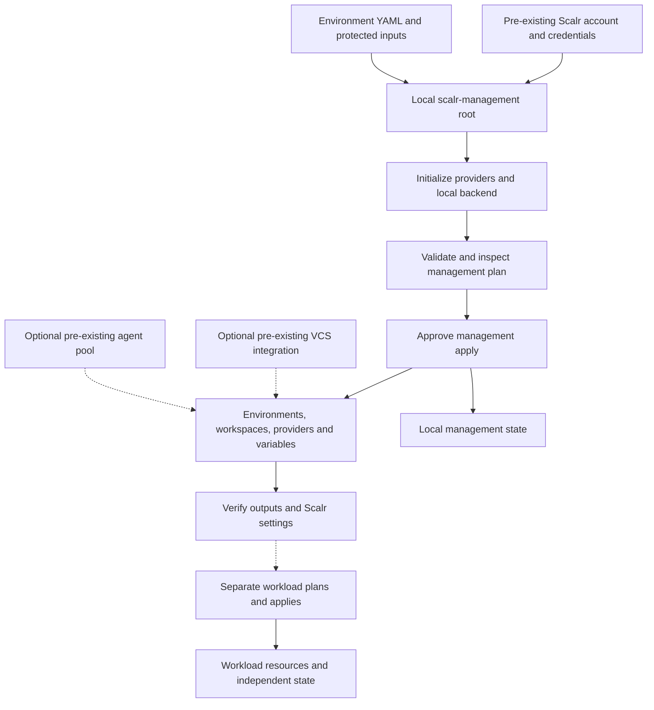

# Bootstrap and change Scalr account configuration

## Scope and safety boundary

Run this workflow from **`scalr-management/`**. This root manages Scalr account configuration: environments, workspaces, centralized provider configurations, and environment/workspace variables. It does **not** provision the VMs, templates, containers, or cloud instances described by workspace names. Creating a workspace is not a workload deployment; a later, independent run of the workload configuration owns that work and its state.

The current YAML definitions have **VCS disabled and every `auto_apply` set to `false`**. They specify remote execution, but remote execution is not the same as VCS-driven execution. Treat README examples describing automatic GitHub synchronization as optional configuration, not current behavior. See [Scalr configuration](../concepts/scalr-configuration.md) for the model and [Provision Proxmox](provision-proxmox.md) for subsequent workload operations.


*Bootstrap/change flow: account credentials precede management configuration; optional integrations and later workload runs are separate responsibilities.*

## Prerequisites and ownership

- Install OpenTofu or Terraform compatible with `required_version = ">= 1.8.0"`. The management root pins the Scalr provider to `registry.scalr.io/scalr/scalr` version `3.11.0`; workload engine versions in YAML are separate settings.
- Obtain an existing Scalr account and an API identity authorized to manage the intended account resources. Supply `account_id` externally; validation requires the `acc-` prefix.
- Authenticate using **`SCALR_HOSTNAME`** and **`SCALR_TOKEN`**, or the CLI credential store via `tofu login <hostname>`. Do not put actual credentials in YAML, review comments, or this documentation. See [Authentication and connectivity](../integrations/authentication-and-connectivity.md).
- Supply **`proxmox_clusters`** externally, even if it is an empty map for a cloud-only setup. It has no default. A cluster requires `endpoint` and either `api_token` or both `username` and `password`. The homelab YAML currently references `proxmox-nexus`, `proxmox-matrix`, and `proxmox-quantum`; reconcile those references with real inputs rather than trusting example names.
- Supply **`proxmox_ssh_key`** when the selected execution path needs private-key SSH. For provider configurations, the key is emitted only when the cluster sets `ssh_agent = false` and this input is non-null; the SSH username is `terraform`. The API credentials do not create that OS user, its permissions, or network reachability.
- Optional cloud inputs are **`digitalocean_token`**, **`digitalocean_spaces_access_key`**, **`digitalocean_spaces_secret_key`**, **`hetzner_token`**, **`infisical_client_id`**, **`infisical_client_secret`**, and **`infisical_host`**. DigitalOcean and Hetzner configurations are conditional on their tokens; Infisical creation is conditional on its client ID, so supply the matching secret as well.
- Optional **`vcs_provider_id`** and an agent pool must already exist in Scalr. This root looks them up; it does not install a GitHub integration or deploy agents. Default agent selection needs both **`agent_pool_name`** and **`agent_pool_environment`**. The latter must name a managed environment. A workspace's YAML `agent_pool_id` takes precedence; the default applies only to workspaces in the selected environment.

Use a protected, ignored input file or another approved secret-injection mechanism. `proxmox_clusters` is deliberately not marked sensitive as a whole because it supplies `for_each` keys; individual provider arguments are marked sensitive. Do not assume all expressions, logs, state, or saved plans are safe to share.

**Initial state owner:** with the checked-in backend block commented out, the operator's local management root owns the initial state. Preserve it securely and avoid parallel operators creating competing local states for the same account. Before working on an existing account, establish who owns the authoritative state; do not bootstrap a second copy just because this checkout lacks state.

The commented remote backend in [main.tf](../../scalr-management/main.tf) is a scaffold, not an active backend. Moving management state into a dedicated Scalr workspace is an **optional separate state-changing procedure**, not part of an ordinary apply. Do not uncomment it or use `tofu init -migrate-state` during the normal workflow below. Route migration, lost state, imports, and recovery to [State and troubleshooting](../operations/state-and-troubleshooting.md).

## Standard bootstrap or change procedure

### 1. Edit the intended configuration

Environment YAML under `data/environments/` is loaded through `environments_data_path`. Environment names become resource keys. Workspace keys are **`environment-name/workspace-name`**, and variable keys extend that with the variable name. Renaming an environment, moving a workspace between environments, or renaming a variable is therefore not merely a cosmetic edit.

Make a narrow change using the recipes below. Separate account changes from workload source changes and state migration so each plan has one reviewable purpose.

### 2. Initialize and validate

```bash
cd scalr-management
tofu init
tofu fmt -check
tofu validate
tofu plan
```

`init` initializes the selected backend and installs the required providers; it does not create Scalr account resources or deploy workloads. On a fresh setup with the current configuration, that backend is local. Review unexpected backend or provider-lock changes before continuing. Initialization and validation do not prove that a token has sufficient permissions or that a remote agent can reach Proxmox.

Use [Local validation](../testing/local-validation.md) for wider repository checks. For this change, the important checks are HCL validation, successful YAML decoding during planning, and a real management plan with the intended inputs and credentials.

### 3. Inspect the complete plan

Do not apply until you can explain every addition, update, replacement, and removal. In particular, inspect:

| Review area | What to stop and investigate |
| --- | --- |
| Resource identity | Environment/workspace/variable key changes, renames, replacements, or resources removed by deleting a YAML entry or file. |
| Provider attachments | Missing names, changed cluster targets, provider removals, or changed aliases. Unknown provider names are filtered out rather than rejected. |
| Sensitive data | Credential values appearing in output or logs, unexpected non-sensitive variables, and protected state/plan handling. Redaction is not encryption of state. |
| Execution context | `execution_mode`, agent pool, IaC platform/version, working directory, `var_files`, VCS branch/triggers, hooks, and `auto_apply`. |
| Scope | Environment-wide variable changes or provider configuration updates affecting more workspaces than the one being edited. |

Deleting a workspace definition plans removal of the Scalr workspace resource; it is not a safe substitute for an intentional workload teardown. Resolve workload/state retention and deletion policy before accepting such a plan. A YAML removal must never be treated as a harmless cleanup.

### 4. Apply only the reviewed intent

```bash
tofu apply
```

Inspect the plan presented by `apply` again, especially if inputs or Scalr configuration changed since the earlier plan. Approve only management resources. Do not use automatic approval for bootstrap or an unfamiliar configuration change.

### 5. Verify outputs and Scalr configuration

```bash
tofu output environments
tofu output workspaces
tofu output workspaces_by_environment
tofu plan
```

Check names and IDs, environment membership, `auto_apply`, and execution mode against the intended change. `provider_configurations`, `provider_configuration_ids`, and `summary` are marked sensitive outputs; inspect them only in a protected terminal if needed, not in shared logs.

In Scalr, verify attached provider configurations **and aliases**, workspace variables and sensitivity, environment variables, engine/version, agent pool, working directory, and VCS settings. The outputs do not expose all those details. A follow-up management plan should explain any remaining differences. Verification is of **account configuration**, not proof of workload provisioning or connectivity; perform workload validation separately.

## Practical change recipes

### Add or modify an environment or workspace

Add an environment YAML file with `name`, `default_provider_configs`, and `workspaces`, or edit the existing homelab/cloud file. For example, append this entry to an existing `workspaces` list, adapting the target provider name to an externally supplied cluster:

```yaml
- name: example-vms
  description: Independently operated VM configuration
  auto_apply: false
  terraform_version: "1.10.0"
  execution_mode: remote
  provider_configs:
    - proxmox-lab
  variables:
    - key: proxmox_node
      value: lab-node
      category: terraform
```

The consumed YAML key is **`provider_configs`**, not the `provider_configurations` spelling used by some README examples. `variables` creates workspace variables (default category `terraform`); `environment_variables` creates workspace shell variables. Both support sensitivity controls. Avoid defining the same Proxmox keys that the root automatically injects.

Workspaces default to `auto_apply: false`, `execution_mode: remote`, and `iac_platform: opentofu`. `working_directory`, `var_files`, hooks, and workspace-specific `agent_pool_id` are supported. Although `run_operation_mode` is decoded, its assignment in `workspaces.tf` is commented out, so adding it to YAML does not currently change Scalr.

A workspace name and variables are scaffolding until an actual workload root, compatible input schema, provider setup, and run path exist. For example, the DigitalOcean droplets root currently contains a commented resource example and a summary output, whereas the Proxmox templates orchestrator calls an active Ubuntu 24.04 module. Do not infer deployability from the inventory of workspace names.

### Add a Proxmox cluster or change an attachment

1. Add a stable key to externally supplied `proxmox_clusters` with its endpoint and authentication. Set SSH/TLS choices deliberately for the eventual runner.
2. Reference it as `proxmox-<cluster-key>` in the environment's `default_provider_configs`, or use workspace `provider_configs` to replace the inherited list.
3. Inspect all affected workspaces, not just the provider configuration resource.

Each cluster creates an account-scoped `bpg/proxmox` custom provider configuration, made available to all managed environments. Environment YAML defaults are expanded into **workspace attachments**; the actual Scalr environment-default assignment is commented out.

Alias behavior follows the implementation, not the simplifying comments: explicit workspace `provider_configs` always uses null aliases; inherited Proxmox defaults use the cluster-name alias, even if only one is inherited. Unknown names are silently omitted. Match these attachments to the workload's provider expectations before applying.

The management root also creates `proxmox_endpoint`, `proxmox_username`, and `proxmox_password` Terraform variables from the **first attached Proxmox configuration**. Username/password are sensitive, and token-only cluster entries can leave those optional fields null. Attaching several clusters does not inject a separate set of variables for each cluster. Review attachment order and aliases as part of any cluster switch.

### Change a shared environment variable

Add or edit a `scalr_variable` resource in [environments.tf](../../scalr-management/environments.tf), setting `account_id`, the intended `environment_id`, `key`, `value`, `category`, and `sensitive` deliberately. For a secret, take the value from a sensitive externally supplied input rather than committing it. Use `category = "terraform"` for a Terraform variable name, or `category = "shell"` for a shell environment variable such as a `TF_VAR_` input.

The current homelab shared variables include sensitive `proxmox_ssh_key`, username `terraform`, `proxmox_insecure = "true"`, and `proxmox_ssh_agent = "false"`. These are explicit resources conditional on the `homelab` environment existing, not a generic environment-variable list loaded from YAML. Review the impact on every consumer and confirm actual workload variable names before adding another shared setting.

### Optionally re-enable VCS

1. Supply an existing `vcs_provider_id` and deliberately add `vcs_repo` to the chosen workspace. Both are required for the resource's VCS block to be emitted.
2. Verify the real repository, branch, and workload root. Prefer workspace-level **`working_directory`**; `vcs_repo.path` is only a compatibility fallback. Do not merely uncomment an old path.
3. Review shared-module dependencies and triggers. `trigger_patterns` takes priority and suppresses `trigger_prefixes`; otherwise explicit prefixes win, then the working-directory fallback. A directory-only trigger does not cover dependencies outside that directory. Check actual module sources, including remote module versions, rather than copying old `shared/modules/...` examples.
4. Review the changed execution context: agent availability, credentials, network access, variable files, hooks, and engine. Keep `auto_apply: false` unless automatic workload application is a separately approved decision.
5. Apply the management change, verify the VCS configuration in Scalr, and then review any resulting workload run separately.

## Source entrypoints

The behavior above is grounded in [YAML normalization and attachment resolution](../../scalr-management/locals.tf), [workspace and variable resources](../../scalr-management/workspaces.tf), [provider configurations](../../scalr-management/provider-configurations.tf), [input definitions](../../scalr-management/variables.tf), and [management outputs](../../scalr-management/outputs.tf). Start with [Quickstart](../quickstart.md) for repository orientation; use [State and troubleshooting](../operations/state-and-troubleshooting.md) for migration and recovery rather than improvising state operations in this workflow.
