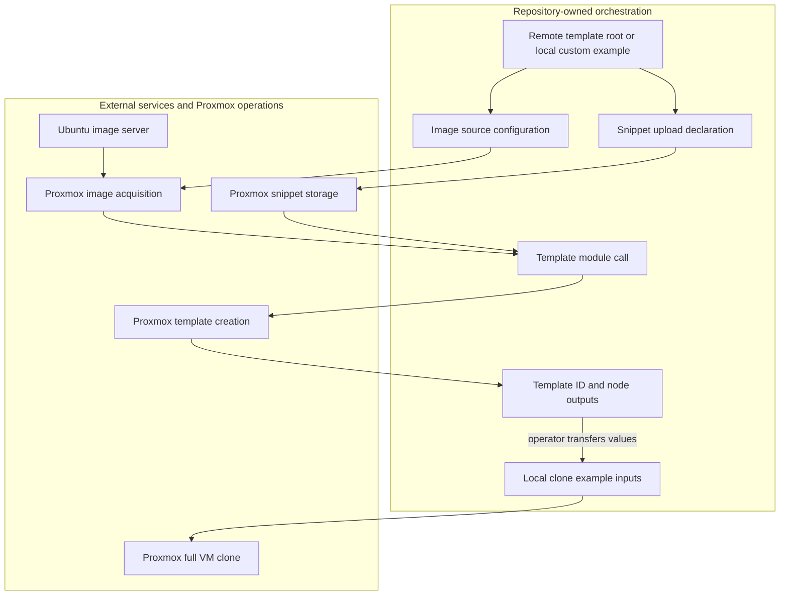

# Provision Proxmox templates and local examples

There are **two separate execution paths**, not one deployment pipeline:

- The [template root](../../deployments/homelab/templates/main.tf) is CLI-triggered but runs remotely with Scalr-managed state and workspace configuration.
- The [standalone examples](../../examples/) execute locally, use `../../terraform-bgp-vm`, and have no automatic Scalr backend or injected provider configuration. Template outputs must be transferred deliberately into clone inputs; there is no remote-state lookup wiring them together.

Ubuntu **24.04 is active** in the remote orchestrator. The Ubuntu 22.04 module, its root outputs, and its summary entry are commented out. Declared Ubuntu 22 variables do not deploy a second template. The active child uses private registry module `the-mothership.scalr.io/proxmox/vm/bgp` at **1.0.1**, not the checkout's standalone module. Both the [root](../../deployments/homelab/templates/versions.tf) and [active child](../../deployments/homelab/templates/ubuntu-24-cloudinit/versions.tf) require `required_version >= 1.8` and `bpg/proxmox ~> 0.90.0`. The [root lockfile](../../deployments/homelab/templates/.terraform.lock.hcl) selects provider **0.90.0**; that provider selection is separate from the private module's **1.0.1** release. See [module contracts](../concepts/proxmox-module-contracts.md) for the underlying module interface.

## Control flow and ownership


*Custom-cloud-init flow: repository configuration coordinates snippet upload and image acquisition before template creation; Proxmox performs the infrastructure operations, and an operator connects outputs to standalone clones.*

Snippet upload and download are independent prerequisites, not necessarily serialized steps. The snippet resource ID feeds `vm_user_data`; the downloaded image ID feeds the imported main disk in the local module. URL-only templates omit the snippet branch. Existing-file templates omit downloading and reference an image already on Proxmox. The registry release is independently versioned: edits to local examples or `terraform-bgp-vm` do not automatically update the private-registry artifact selected by the remote child. Inspect its installed code and plan rather than assuming every checkout implementation detail also applies to version 1.0.1.

## Safety gates before either procedure

1. **Establish state ownership and endpoint together.** Record the backend/workspace, API endpoint, provider configuration, node, storage, and IDs before initialization. An endpoint change against existing state is not a cluster-selection mechanism.
2. **Resolve files from the execution root.** The remote root defaults `user_data_file` to `./shared/user-data.yaml`, passed unchanged into the child resource's `source_file.path`. It is relative to the root working directory, not automatically rebased to `ubuntu-24-cloudinit`. Confirm `shared/user-data.yaml` is in the uploaded remote configuration. The local custom example defaults to `user-data.yaml` in its own working directory; the repository supplies `user-data.yaml.example`, which must be copied and edited. These paths refer to files on the runner, not paths on Proxmox.
3. **Check storage content support, not just storage names.** Disk storage defaults to `local-lvm`; image storage defaults to file-based `local`, not block-based `local-lvm`. The local module downloads with `content_type = "iso"` and references existing images as `<datastore>:iso/<filename>`. Ensure ISO content is enabled there. Snippet uploads use `content_type = "snippets"`; enable snippets on the selected file storage. Also verify that the cloud-init drive and disk/EFI storage are usable on each target node and have capacity.
4. **Pin and validate image provenance.** The remote Noble URL points at a moving `current` image and the checksum defaults to `null`. Set `ubuntu_24_cloud_image_checksum` for the exact artifact. Local URL/custom examples expose `cloud_image_checksum`; the standalone module defaults its algorithm to `sha256` and only passes an algorithm when a checksum exists. These wrappers do not expose an algorithm override. Existing-file mode does not download or checksum the supplied artifact: validate it before provisioning.
5. **Verify connectivity and guest access separately.** The runner needs API reachability and template operations need host SSH access. A Scalr runner does not inherit your laptop's SSH agent. Guests need reachable bridges, correct VLANs, gateway/subnet values, usable DNS and, for DHCP template settings, an appropriate network. Defaults such as `vmbr0` and DNS `["1.1.1.1", "8.8.8.8"]` are assumptions, not discovered infrastructure.
6. **Reserve identifiers and check clone sources.** Ensure template IDs, VM IDs, names, snippet filenames, image filenames, IPs and deterministic MACs will not collide with existing infrastructure or another state. The remote default template ID is `9001`. Confirm the source template exists on the source node and that node is available. The single-VM example omits `src_clone.node_name`, so the local module uses the target node as source; the MicroK8s example supplies `template_node` explicitly. Cross-node clones still require suitable cluster/storage access.

The [shared remote snippet](../../deployments/homelab/templates/shared/user-data.yaml) creates an `ansible` account with supplied public keys, password SSH disabled, passwordless sudo, a guest-agent package, package upgrades, and a reboot request. Replace keys and review policy before use. Do not assume `ubuntu` is the login account or that clone-supplied users override inherited custom user-data. Inspect the resulting Proxmox cloud-init configuration and test an actual guest login. See [authentication and connectivity](../integrations/authentication-and-connectivity.md).

## Procedure A — CLI-triggered remote templates

### Prerequisites, credentials and state gate

Work in `deployments/homelab/templates`. Have Scalr login/registry access, a provisioned CLI-driven workspace, a runner that reaches the cluster, and the matching workspace variables and provider configuration. The provider block reads `proxmox_endpoint`, `proxmox_username`, `proxmox_password`, `proxmox_insecure`, and SSH agent/username/private-key inputs. Its default SSH agent setting is false, with a sensitive `proxmox_ssh_key`; do not put private keys into tracked tfvars. Verify TLS policy explicitly because `proxmox_insecure` defaults to true.

**Stop and review [backend.tf](../../deployments/homelab/templates/backend.tf) first:** it currently selects hostname `the-mothership.scalr.io`, organization `homelab`, workspace **`vm-templates-nexus`**. The [workspace YAML](../../scalr-management/data/environments/homelab.yaml) declares three independent remote template workspaces, all with `auto_apply: false` and commented-out VCS bindings:

| Workspace | Attached provider configuration | YAML node |
| --- | --- | --- |
| `vm-templates-nexus` | `proxmox-nexus` | `bravo` |
| `vm-templates-matrix` | `proxmox-matrix` | `foxtrot` |
| `vm-templates-quantum` | `proxmox-quantum` | `lloyd` |

Those declarations do not make this backend dynamic. Changing `proxmox_node` alone neither selects another workspace nor changes its credentials/state owner. To target another cluster, deliberately select the intended backend workspace and align endpoint, credentials, attached provider configuration, node and storage. Inspect existing state in both workspaces first. Do not blindly accept state migration during reinitialization: these are separate cluster inventories, not copies of Nexus state. Resolve any migration/reconfiguration prompt as a state-management decision before running a plan. See [state and troubleshooting](../operations/state-and-troubleshooting.md) and [Scalr management](manage-scalr.md).

### Commands and review

Only after the gates above, from the repository root:

```sh
cd deployments/homelab/templates
tofu login the-mothership.scalr.io
tofu init
tofu validate
tofu plan
```

Login establishes Scalr authentication; initialization selects the configured remote state and installs modules/providers, including the private release. Validation checks configuration, not live storage/SSH readiness. `plan` submits a remote run and displays its result locally; the workspace stores state in Scalr. Review the workspace identity and effective endpoint/node, snippet path and destination, image URL/checksum, VM ID, storage, and every replacement/deletion. An unchanged deployment may show no changes; do not require an exact creation count across registry versions.

With auto-apply disabled, planning is not permission to deploy. After reviewing the proposed changes:

```sh
tofu apply
```

This initiates remote apply flow; review its plan/approval prompt or Scalr run approval before authorizing it. Do not use `-auto-approve` as a substitute for review. A previously displayed standalone plan is not a guarantee that a later apply has identical inputs.

### Expected resources and verification

The active child declares one snippet upload and an image-mode template module with Noble image acquisition, an EFI disk, an imported `scsi0` disk (default 5 GB), DHCP on the selected bridge, DNS, and custom user-data. `vm_template = true` and both start flags are false: **a stopped template is expected, not an SSH-ready guest**.

```sh
tofu output templates_summary
tofu output ubuntu_24_template_id
tofu output ubuntu_24_template_node
tofu output ubuntu_24_cloud_init_file_id
```

Compare `templates_summary` endpoint/node to the intended cluster. In Proxmox verify the returned ID is a template, its name/node/storage are correct, its imported disk and EFI disk exist, and the referenced snippet is present. The root also exports `ubuntu_24_template_name`. Save the actual ID and node for clone inputs rather than assuming local example defaults match.

**Recovery limit:** failed remote runs can leave partial resources. Inspect the remote run, workspace state and Proxmox inventory before retrying. Correct missing files, SSH permissions, unsupported content types or checksum failures, then re-plan against the same state. Do not delete state, migrate it to another cluster, or destroy shared images/snippets as a generic retry strategy. No workflow-level rollback or guest boot test is implemented here.

## Procedure B — local standalone examples

### Choose a root and prepare local credentials

Each directory is a separate root with its own state lifecycle:

| Working directory | Operation and expected resources |
| --- | --- |
| `examples/template-from-url` | Download an image and create a stopped template using the local module. |
| `examples/template-from-file` | Create a stopped template from an existing Proxmox ISO-content image; no managed download. |
| `examples/template-with-custom-cloudinit` | Upload a snippet, download an image and create a stopped custom-data template. |
| `examples/single-vm` | Full clone of one template, with configured CPU, memory, disks, static addressing and optional secondary NIC. |
| `examples/microk8s-cluster` | Three full-clone VMs via `for_each`; **no MicroK8s installation, joining or health checks**. |

All use local source `../../terraform-bgp-vm`, not registry version 1.0.1. Their local provider configurations require an endpoint and accept API authentication through `PROXMOX_VE_USERNAME`/`PROXMOX_VE_PASSWORD` or `PROXMOX_VE_API_TOKEN`. Template providers additionally configure SSH with `agent = true`; load a suitable host key into your local agent and set `ssh_username`. Guest public keys in `ssh_public_keys` are a separate concern from host SSH authentication.

There is no declared remote backend in these examples: absent an intentional backend change, commands run on your machine and state is local to the selected root (`terraform.tfstate`). Local examples do not receive the Scalr workspace's provider attachment, variables, secrets or network reachability. Protect state and credential files.

### Configure, plan and apply

For example, to provision a single clone after recording the template outputs:

```sh
cd examples/single-vm
cp terraform.tfvars.example terraform.tfvars
```

Edit that file before proceeding: set your endpoint/node/storage, `template_id`, unique VM ID, network/gateway/DNS, username, public keys and start policy. For another example, use its directory and its own variable file instead. In the custom-data example also copy and edit the snippet:

```sh
cp user-data.yaml.example user-data.yaml
```

Do not run that snippet-copy command in roots without that file. For MicroK8s, review `main.tf` as well as variables: target nodes are hard-coded as `holly`, `mable`, `lloyd`; primary addresses are `192.168.30.101`–`103`. Environment offsets are dev 2000, staging 3000, prod 4000 plus 101–103, and MACs are deterministic. These conventions do not check collisions or discover your cluster.

After configuring API environment credentials securely and completing the safety gates:

```sh
tofu init
tofu validate
tofu plan -out=reviewed.tfplan
tofu apply reviewed.tfplan
tofu output
```

Initialization installs providers/local modules. Planning reads infrastructure and saves the reviewed proposal locally; applying that saved plan changes Proxmox and writes local state. Treat the plan as sensitive. Re-plan after input changes rather than applying an obsolete file.

For clones, the local module always requests a **full** clone. It requires the appropriate clone/image source, requires an EFI disk for OVMF, and rejects setting both `vm_init.user` and `vm_user_data`. It also ignores later changes to cloud-init user accounts and template conversion in lifecycle handling; changing guest keys in configuration is not a reliable key-rotation procedure for an existing guest.

### Verify and recover

Template examples output `template_id`, `template_name`, `template_node`; custom-data also returns `cloud_init_file_id`. Transfer the verified ID/node into a clone example's inputs explicitly. Inspect the Proxmox template before cloning.

For the VM examples inspect VM IDs, target nodes, disks, NICs, start state and console, then test SSH with the account/key actually configured. MicroK8s outputs include `cluster_nodes`, `cluster_ips`, `cluster_ids` and an inventory map. The local module's `primary_ip` prefers non-loopback guest-agent addresses but falls back to the configured first-interface address (potentially even `dhcp`), then `N/A`. Output presence is therefore **not evidence of network reachability or application health**. Generated SSH commands also need checking against the actual guest username.

On failure preserve local state and compare it with Proxmox before retrying. Do not point two local roots at the same IDs or reuse one state for another cluster. Review a fresh plan for partial creation and replacements. Destruction is an explicit infrastructure operation, not a reset button: it can remove resources still needed by clones or other workflows, while externally supplied images are outside download-resource ownership.

## Validation boundaries and further reading

The checked-in `tests/unit`, `tests/integration` and `tests/terratest` contain README placeholders, not executable coverage for this path. Use validation and plan review as configuration checks, followed by live Proxmox and guest verification. The tiny deployment/testing scripts and references to absent `build-template.sh` are not implementations of this workflow. Likewise, the scaffold single-VM, LXC and cluster deployment roots must not be treated as callers of these standalone examples.

Continue with [local validation](../testing/local-validation.md), [state recovery](../operations/state-and-troubleshooting.md), or the [quickstart](../quickstart.md).
